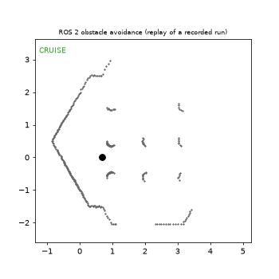

# ros2-obstacle-avoidance-robot

ROS 2 Jazzy obstacle avoidance for a TurtleBot3 in Gazebo, built as a tested finite state machine.




*Replay of one recorded simulation run (not a screen capture): grey dots are the robot's own LiDAR hits, the path is coloured by commanded state (green cruise, orange/red turning).*

## How it works

**Scan to sectors.** `core/scan_sectors.py` reduces each 360-sample LiDAR scan to three numbers: the closest valid reading in the front (+/-30 deg), left (30 to 90 deg) and right (-90 to -30 deg) sectors. `inf` and `nan` readings count as "nothing seen".

**Sectors to state.** `core/state_machine.py` is a four-state machine (CRUISE, TURN_LEFT, TURN_RIGHT, BACKUP). Turns start at 0.50 m and end at 0.80 m, so the robot does not flicker at the boundary, and the turn direction is chosen once on entry. See [docs/state_machine.md](docs/state_machine.md).

**State to velocity.** `core/velocity_policy.py` maps each state to a fixed linear and angular velocity. The ROS node (`nodes/avoidance_node.py`) only wires these pure functions to `/scan` and `/cmd_vel`; no decisions live in it.

## Quick start

Requires WSL2 with Ubuntu 24.04. Clone into the Linux filesystem (for example `~/ros_ws/src`), not `/mnt/c` or `/mnt/d`: the Windows drive is slow enough that ROS logging stalls for seconds.

```bash
./scripts/setup_wsl.sh
source /opt/ros/jazzy/setup.bash
cd ~/ros_ws && colcon build --symlink-install --packages-select obstacle_avoidance
source install/setup.bash
export TURTLEBOT3_MODEL=waffle
ros2 launch obstacle_avoidance avoidance_sim.launch.py
```

On this project's machine (Intel integrated graphics) the simulation ran at roughly a quarter of real time, with software rendering (`LIBGL_ALWAYS_SOFTWARE=1`) forced during every test; scans arrived at about 1.3 Hz wall-clock instead of the nominal 5 Hz. Expect much slower robot progress than the numbers suggest.

## Run the tests

```bash
pytest -q          # 26 tests, no ROS needed
ros2 run obstacle_avoidance run_monitor --duration 120
```

`run_monitor` listens to `/scan` and exits 0 if the closest reading stayed at or above `--collision-m` (default 0.20 m), otherwise 1. The default is 0.20 m, not the sensor's 0.12 m minimum, because a robot pressed against a wall measured about 0.20 m on its LiDAR; a 0.12 m limit could never trigger.

## Tuning

All values live in `obstacle_avoidance/config/params.yaml`.

| Parameter | Default | Effect |
|---|---|---|
| `turn_enter_m` | 0.50 | front distance that starts a turn |
| `turn_exit_m` | 0.80 | front distance that ends a turn (must exceed enter) |
| `backup_enter_m` | 0.22 | front distance that triggers a backup |
| `backup_max_s` | 1.5 | longest backup |
| `cruise_mps` | 0.15 | forward speed |
| `turn_radps` | 0.8 | turn rate |
| `backup_mps` | -0.08 | reverse speed |
| `front_half_angle_deg` / `side_angle_deg` | 30 / 90 | sector widths |
| `use_stamped_cmd` | true | Jazzy's TurtleBot3 bridge takes `TwistStamped` on `/cmd_vel` |

The defaults above were not changed during testing.

## Results

Three consecutive runs, 360 s of wall-clock each, `turtlebot3_world`, waffle, stock parameters, software rendering. Shorter 120 s runs showed no state changes at this simulation speed, so they were not used for the results.

| Run | Min LiDAR range | State changes | `run_monitor` | Shutdown |
|---|---|---|---|---|
| 1 | 0.306 m | 6 | exit 0 | zero velocity published |
| 2 | 0.253 m | 6 | exit 0 | zero velocity published |
| 3 | 0.256 m | 6 | exit 0 | zero velocity published |

Each run was 3 turns and 3 recoveries to CRUISE. BACKUP never triggered in the recorded runs. A deliberate crash (driving straight with no controller) was reported as FAIL, exit 1, with a minimum range of 0.120 m.

## Limitations

- Reactive only: no map, no goal; it can loop in symmetric corridors.
- Simulation only; nothing here was run on real hardware.
- Runs are short in robot time because of the slow simulation, and the world has few obstacles, so these results show the logic works, not how it scales.
- The demo is a replay built from recorded odometry and scans, so wall outlines look doubled where odometry drifted.

## Next steps

Nav2 integration, SLAM, a real TurtleBot3.

## Layout

`obstacle_avoidance/` is the ROS 2 package (`core/` pure logic, `settings.py` parameter loading, `nodes/` ROS wiring). `scripts/record_run.py` and `scripts/make_demo_gif.py` produced the demo. The measured environment is in [docs/environment.md](docs/environment.md).

## License

MIT
