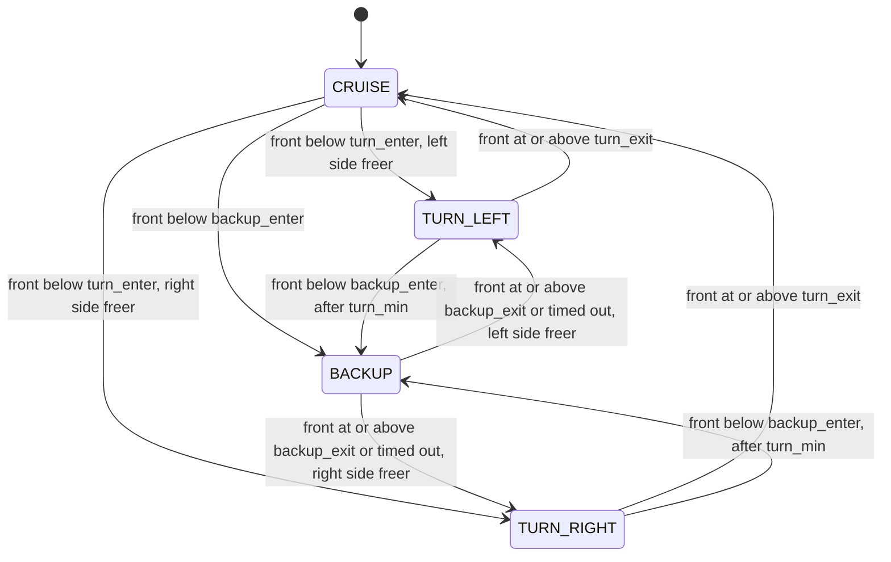

# State machine

Rules are evaluated top to bottom; the first match wins.

| From | Condition | To |
|---|---|---|
| CRUISE, or a turn that has lasted at least `turn_min_s` | `front_m < backup_enter_m` | BACKUP |
| BACKUP | `front_m >= backup_exit_m` or `seconds_in_state >= backup_max_s` | TURN_LEFT if `left_m >= right_m` else TURN_RIGHT |
| CRUISE | `front_m < turn_enter_m` | TURN_LEFT if `left_m >= right_m` else TURN_RIGHT |
| TURN_LEFT / TURN_RIGHT | `front_m >= turn_exit_m` | CRUISE |
| otherwise | none | stay |

The thresholds must satisfy `backup_enter_m < backup_exit_m < turn_enter_m < turn_exit_m`; loading the settings fails otherwise.

## Why these rules

- **Hysteresis.** `turn_exit_m` (0.80) is larger than `turn_enter_m` (0.50), so the robot does not flicker between CRUISE and a turn at the boundary. The turn direction is picked once, on entry, and never flipped mid-turn.
- **BACKUP leaves on distance, not only on time.** The robot reverses at 0.08 m/s, so the 1.5 s timeout alone gives about 0.12 m of travel, not enough to reach the 0.80 m turn exit. `backup_exit_m` (0.30) lets BACKUP end as soon as there is a little room. The timeout remains as the fallback.
- **A new turn cannot go straight back to BACKUP.** Without `turn_min_s` (1.0 s), a robot wedged against a wall would flip BACKUP, TURN, BACKUP on consecutive ticks and never rotate far enough to find a way out. With it, a wedged robot alternates slowly (a unit test covers this).
- **BACKUP is blind.** There is no rear sensing, so reversing assumes the space behind is clear. The slow speed and short duration limit the risk but do not remove it.
