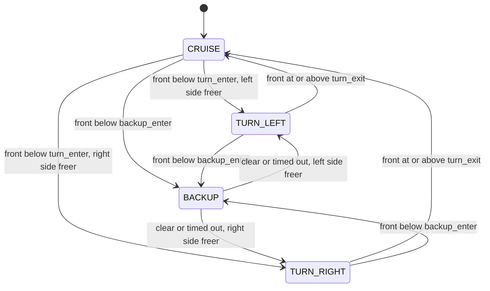

# State machine

Rules are evaluated top to bottom; the first match wins.

| From | Condition | To |
|---|---|---|
| any except BACKUP | `front_m < backup_enter_m` | BACKUP |
| BACKUP | `front_m >= turn_exit_m` or `seconds_in_state >= backup_max_s` | TURN_LEFT if `left_m >= right_m` else TURN_RIGHT |
| CRUISE | `front_m < turn_enter_m` | TURN_LEFT if `left_m >= right_m` else TURN_RIGHT |
| TURN_LEFT / TURN_RIGHT | `front_m >= turn_exit_m` | CRUISE |
| otherwise | none | stay |

`turn_exit_m` (0.80) is larger than `turn_enter_m` (0.50): this hysteresis stops the robot from flickering between CRUISE and a turn at the boundary. The turn direction is picked once, on entry, and never flipped mid-turn.
